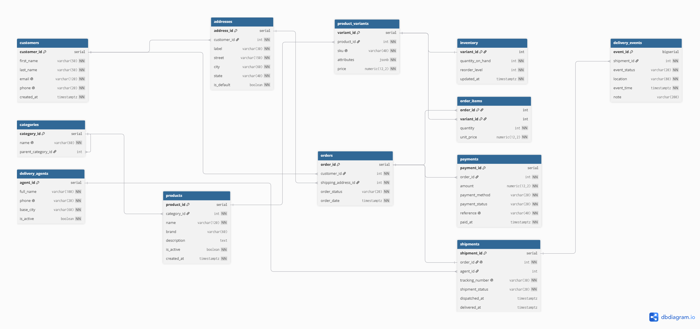
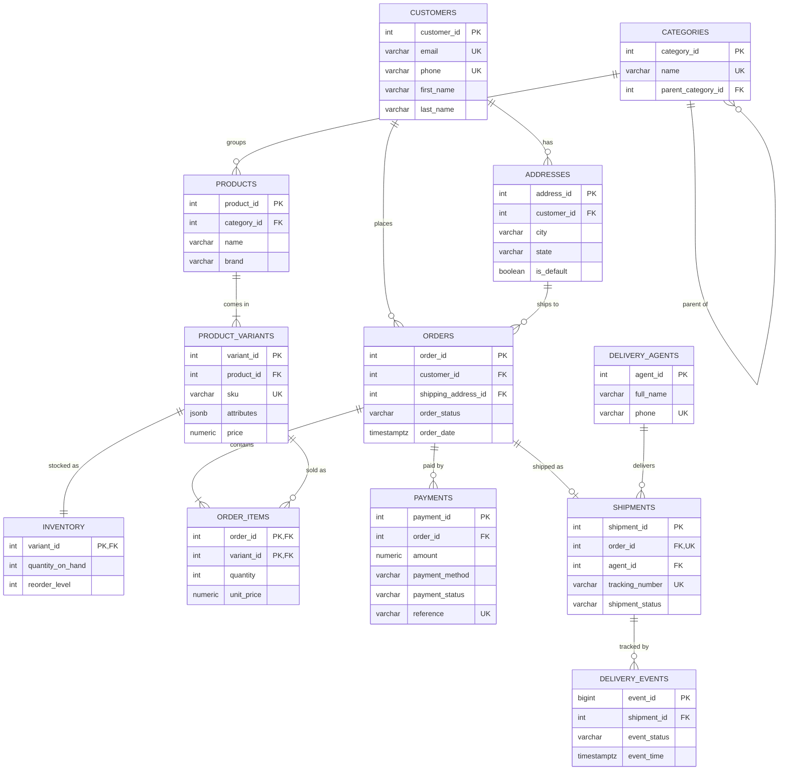

# Portfolio 1 — Database Design and Modelling

**Case study:** ShopNaija Online Marketplace (simulated e-commerce platform)
**Database:** PostgreSQL

## Contents of this folder

| File | What it is |
|---|---|
| `01_schema.sql` | Creates the 12 tables with primary keys, foreign keys and constraints |
| `02_seed_data.sql` | Generates realistic simulated data (5,000 customers, 100,000 orders, ~250,000 order items) |
| `03_constraint_tests.sql` | Tries to insert 11 kinds of bad data and proves each is rejected |
| `erd.dbml` | Source of the ER diagram (for dbdiagram.io) |
| `erd.png` | Exported ER diagram |
| `normalisation.md` | Step-by-step normalisation from UNF to 3NF/BCNF, plus design decisions |
| `evidence/` | Screenshots of the scripts running |

## How to run

1. In pgAdmin, create a database called `shopnaija`.
2. Open the Query Tool on `shopnaija` and run, in order:
   `01_schema.sql` → `02_seed_data.sql` → `03_constraint_tests.sql`.
3. `02_seed_data.sql` ends by printing row counts; `03_constraint_tests.sql` prints
   11 `PASS` messages in the Messages tab.

## ER Diagram

The same diagram in Mermaid (GitHub renders it automatically):

## Keys and constraints summary

| Type | Where it is used | Business rule it protects |
|---|---|---|
| Primary keys | Every table (composite on `order_items`) | Each record is uniquely identifiable; a variant appears once per order |
| Foreign keys | 13 relationships (see diagram) | No order for a missing customer, no item for a missing product |
| `UNIQUE` | email, phone, sku, payment reference, tracking number | No duplicate accounts, products, payments or parcels |
| `CHECK` | prices > 0, stock ≥ 0, quantity > 0, allowed status values, delivery after dispatch, attributes is a JSON object | Invalid business data is impossible |
| Partial unique index | `addresses (customer_id) WHERE is_default` | At most one default address per customer |
| `ON DELETE RESTRICT` | orders → customers | Order history is never lost |
| `ON DELETE CASCADE` | items, payments, shipments, events | Removing an order removes its dependent records |

## Normalisation

See [normalisation.md](normalisation.md) for the full walk-through from UNF to 3NF/BCNF.

## Evidence

| Screenshot | Shows |
|---|---|
| `evidence/p1-tables-created.png` | The 12 tables in pgAdmin after running the schema |
| `evidence/p1-seed-row-counts.png` | Row counts printed by the seed script |
| `evidence/p1-constraint-tests.png` | All 11 constraint tests passing |
| `evidence/p1-sample-data.png` | Sample product variants with JSONB attributes |
