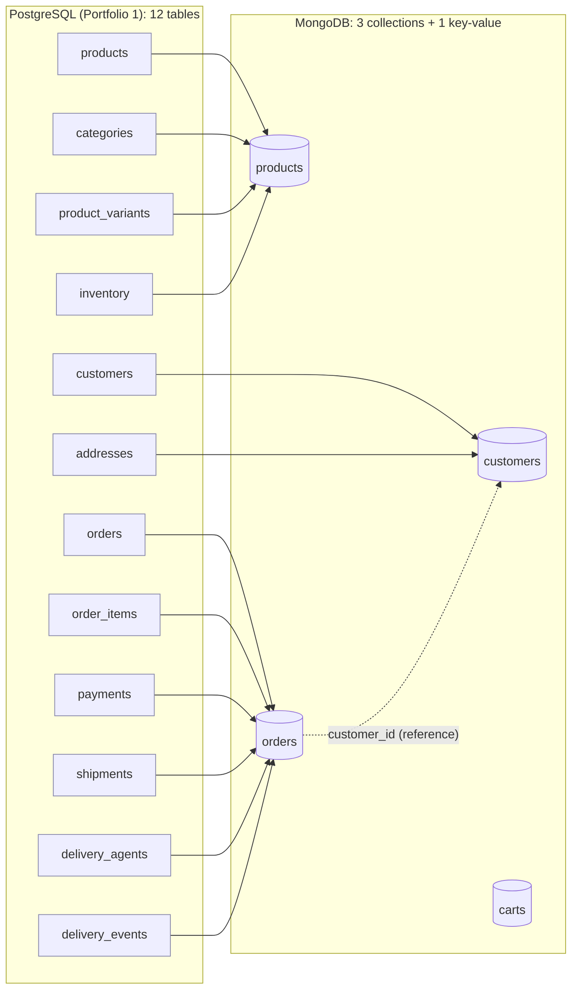

# Portfolio 4 — NoSQL and Advanced Data Models

**Case study:** ShopNaija Online Marketplace
**Databases:** MongoDB (document and key-value models), migrated from the Portfolio 1 PostgreSQL data

## Aim

Remodel the *same* ShopNaija data as MongoDB documents, implement the shop's core
operations on it, and judge honestly which parts of the business suit a document
database and which should stay relational.

## Contents of this folder

| File | What it is |
|---|---|
| `01_export_from_postgres.sql` | Turns 12 relational tables into 3 kinds of JSON document (run in psql) |
| `02_load_mongodb.js` | Creates the collections **with schema validation rules** and loads the documents |
| `03_crud.js` | Create, read, update and delete on the document model, including the flash-sale stock update |
| `04_aggregation.js` | Five reports built with the aggregation pipeline, cross-checked against SQL |
| `05_indexes_explain.js` | Three indexes with `explain()` before and after (compare Portfolio 2) |
| `06_key_value_cart.js` | Key-value model: shopping cart keyed by session ID, with automatic expiry |
| `results/` | Saved output of scripts 02–06 |
| `evidence/` | Screenshots from MongoDB Compass and the terminal |
| `.gitignore` | Keeps the 150 MB `data/` export out of GitHub (it can be regenerated) |

## From 12 tables to 3 collections



**Example order document** (one read returns what needed a 6-table join in SQL):

```json
{
  "_id": 1,
  "customer_id": 2955,
  "customer_name": "Musa Bello",
  "status": "delivered",
  "order_date": "2026-09-01T06:15:23Z",
  "shipping_address": { "street": "96 Ogui Rd", "city": "Onitsha", "state": "Anambra" },
  "items": [
    { "sku": "SKU-1287-1", "product_name": "Lisa Folawiyo Dress 1387", "category": "Fashion",
      "quantity": 2, "unit_price": 36300 }
  ],
  "total": 72600,
  "payments": [ { "method": "wallet", "status": "successful", "amount": 72600, "reference": "PAY-0000001-A" } ],
  "shipment": {
    "tracking_number": "SNG000000001", "status": "delivered",
    "agent": { "name": "Temitope Lawal", "phone": "09000000027" },
    "events": [
      { "status": "in_transit",       "location": "ShopNaija Hub, Lagos" },
      { "status": "out_for_delivery", "location": "Onitsha" },
      { "status": "delivered",        "location": "Onitsha" }
    ]
  }
}
```

## Design decisions: embed or reference?

The rule applied: **embed data that is read together and has a natural size limit;
reference data that grows without limit or is shared and changes independently.**

| Data | Decision | Reason |
|---|---|---|
| Variants and stock **inside** products | Embed | A product has a handful of variants, always shown together on the product page. Keeping stock inside the same document also makes "check stock and reduce it" a single atomic operation (see CRUD, UPDATE 3). |
| Category **inside** products | Embed (copy) | Only 15 categories that almost never change; copying the name avoids a lookup on every product view. |
| Addresses **inside** customers | Embed | A customer has 1–3 addresses, always loaded with their profile. |
| Items, payments, shipment, tracking events **inside** orders | Embed | All bounded in size, all belong to exactly one order, and "show me my order" needs every one of them at once. |
| Customer **referenced** from orders (`customer_id`) | Reference | A customer can place unlimited orders. Embedding orders inside the customer would grow the document forever (MongoDB's limit is 16 MB per document). |
| Product name, price and customer name **copied** into orders | Snapshot | An order is a historical record. It must show the name and price **at the time of purchase**: the same reason `order_items.unit_price` exists in Portfolio 1. If the product is renamed later, old invoices must not change. |
| `total` stored on each order | Stored | In SQL the total was deliberately *not* stored (Portfolio 1) because it could drift from the item rows. Here the items live inside the same document and never change after checkout, so storing the total is safe, and it makes revenue reports a single pass (Report B). |

## Results

**Collections loaded** (from `results/02_load_output.txt`)

| Collection | Documents | Average size (bytes) | Replaces SQL tables |
|---|---|---|---|
| products | 2,001 | 588 | 4 |
| customers | 5,000 | 368 | 2 |
| orders | 100,002 | 1,202 | 6 |

**Reports cross-checked against SQL** (from `results/04_aggregation_output.txt`): revenue by category for 2026

| Category | MongoDB revenue (NGN) | PostgreSQL revenue (NGN) | Match |
|---|---|---|---|
| Electronics     | 23,922,643,400 | 23,922,643,400 | ✓ |
| Home & Kitchen  |  6,248,263,200 |  6,248,263,200 | ✓ |
| Fashion         |  2,327,545,800 |  2,327,545,800 | ✓ |
| Groceries       |    981,843,700 |    981,843,700 | ✓ |
| Health & Beauty |    337,418,200 |    337,418,200 | ✓ |

**Indexes** (from `results/05_indexes_output.txt`)

| Query | Returned | Before: plan | Docs examined / time | After: plan | Docs examined / time |
|---|---|---|---|---|---|
| Q1 customer history | 29 | `SORT <- COLLSCAN` | 100,002 / 882 ms | `FETCH <- IXSCAN(idx_customer_date)` | 29 / 220 ms |
| Q2 track a parcel | 1 | `COLLSCAN` | 100,002 / 195 ms | `EXPRESS_IXSCAN(idx_tracking)` | 1 / 14 ms |
| Q3 256GB / 16GB variants | 69 | `COLLSCAN` | 2,001 / 12 ms | `FETCH <- IXSCAN(idx_variant_storage_ram)` | 69 / 15 ms |

Every index cut the documents examined to exactly the number returned, so MongoDB read
no unnecessary documents. Q1 also lost its `SORT` stage, because the index already stores
each customer's orders newest-first. Q2 used `EXPRESS_IXSCAN`, a fast path MongoDB takes
for an equality match on a unique index. Q3's time did not improve (12 ms → 15 ms): the
products collection is only 2,001 small documents, so reading it whole is already fast,
the same lesson as Q8 in Portfolio 2. The index pays off as the catalogue grows. Single
timings in milliseconds vary between runs; *documents examined* is the reliable measure.

## Analysis

**Flexible schema, still with rules.** Adding a solar generator with brand-new attributes
(wattage, battery type, a list of outlets) needed no schema change at all (CRUD, CREATE 1).
That flexibility did not mean giving up data quality: the `$jsonSchema` validators rejected
an order with an invalid status and a quantity of 0 (CREATE 2), playing the role the CHECK
constraints played in Portfolio 1. The difference is that the rules cover only the fields
that matter, so `attributes` can still differ from product to product.

**Reads that SQL had to join are single lookups.** Tracking a parcel needed
`shipments JOIN delivery_events` in SQL, and Portfolio 2 found that join scanning 264,000 rows
until an index was added. In MongoDB the events live inside the order, so it is one
document read. The same is true for showing a full order (6 tables in SQL).

**The flash sale without locks.** In Portfolio 3, two customers buying the last phone
caused overselling until locking was added. In MongoDB, the condition (`stock ≥ 1`) and the
decrement are a single update on a single document, and **single-document writes are atomic**,
so the second buyer simply gets `modifiedCount: 0`. This works *only because* the design
put the stock inside the product document. An operation that must change **several**
documents together (e.g. reduce stock **and** create the order) needs a multi-document
transaction, which MongoDB supports only on a replica set: this is set up in Portfolio 5.

**Aggregation instead of SQL reporting.** All five reports match the equivalent SQL
exactly (revenue by category checked line by line). Report B is simpler than its SQL
version because each order already carries its total; Report C shows that MongoDB *can*
join (`$lookup`), but the design keeps it to the rare report that needs one.

**Indexes work the same way, with one addition.** Without indexes, every query read every
document (`COLLSCAN`), just like a Seq Scan. With them, MongoDB jumped straight to the
matches (`IXSCAN`). The new idea is the **multikey index** (Q3): because `variants` is an
array, MongoDB creates one index entry per variant, so it can search inside arrays efficiently.
The tracking index is also a **partial unique** index: unique only for orders that have a
shipment, so the thousands of pending orders without one don't clash.

**Key-value model.** The shopping cart is looked up only by its session ID, never joined or
reported on, and should vanish when abandoned, so a key-value design fits it best. A TTL index
deletes carts 30 minutes after their last change, with no clean-up job. In production a
dedicated in-memory key-value store such as Redis would be faster still.

**The costs of the document model.** Data is duplicated (customer names and product
details are copied into orders), so changing them in one place does not change them
everywhere, which is right for order history but wrong for, say, a customer's current
email. Cross-cutting questions such as "total stock across all products" are less natural
than in SQL, and integrity across collections (does `customer_id` 2955 actually exist?)
is not enforced by the database: there are no foreign keys.

## Suitability: SQL or NoSQL for ShopNaija?

| Part of the business | Best fit | Why |
|---|---|---|
| Payments, refunds, order of record | **PostgreSQL** | Money needs multi-row ACID transactions, foreign keys and strict constraints |
| Inventory at checkout | **PostgreSQL** (or MongoDB with stock embedded per product) | Correctness under heavy concurrency is critical (Portfolio 3) |
| Product catalogue and search filters | **MongoDB** | Every category has different attributes; products are read far more than written |
| Order history and parcel tracking for customers | **MongoDB** | Read as whole units; high read volume; easy to spread across servers (Portfolio 5) |
| Shopping carts and sessions | **Key-value (Redis / MongoDB TTL)** | Simple get/put by key, short-lived, very high traffic |
| Finance and management reporting | **PostgreSQL** | Complex ad-hoc joins and aggregates across the whole business |

**Recommendation:** a *polyglot persistence* design. PostgreSQL stays the system of record
for money and stock, while MongoDB serves the product catalogue and the customer-facing
order and tracking views, and a key-value store holds carts. Each part of the shop then uses
the model that matches how its data is actually read and written.

## Evidence

| File | Shows |
|---|---|
| `evidence/p4-compass-collections.png` | The three collections and document counts in MongoDB Compass |
| `evidence/p4-compass-order-document.png` | A full order document with embedded items, payments and tracking |
| `evidence/p4-compass-different-shapes.png` | Products with different attribute shapes in one collection |
| `evidence/p4-validation-rejected.png` | Schema validation rejecting a bad order |
| `evidence/p4-flash-sale.png` | Second buyer gets `modifiedCount: 0` |
| `evidence/p4-compass-explain.png` | Compass Explain Plan showing IXSCAN |
| `evidence/p4-cart.png` | Key-value cart output |
