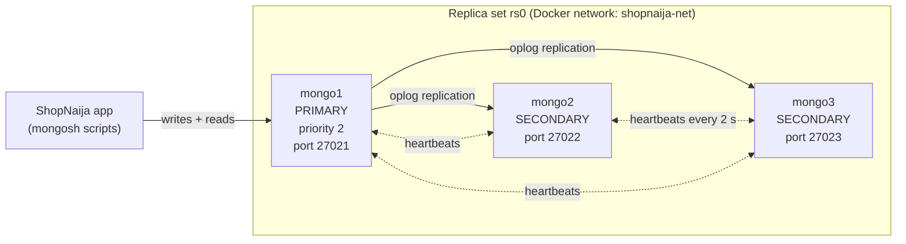
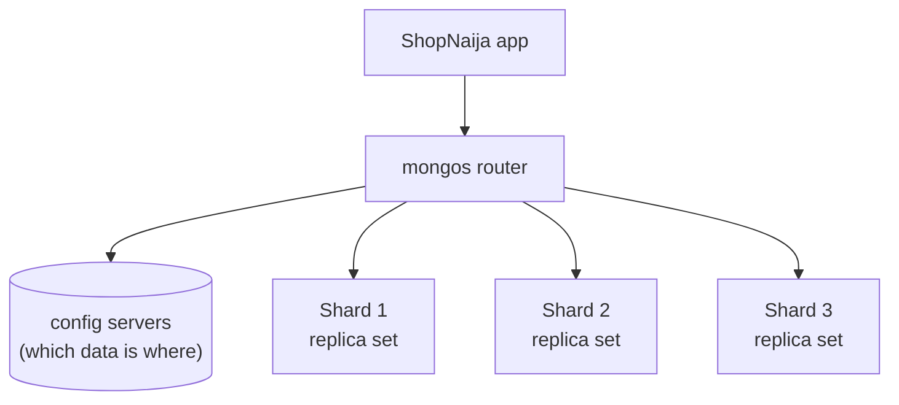

# Portfolio 5 — Distributed and Cloud Databases

**Case study:** ShopNaija Online Marketplace
**Setup:** a 3-member MongoDB replica set in Docker, loaded with the Portfolio 4 ShopNaija documents

## Aim

Show how ShopNaija's database keeps working when a server fails, what "consistent"
means once data lives on several servers, and how the shop would grow beyond one
machine (sharding) and be deployed in the cloud.

## Architecture

All writes go to the **primary**. Each secondary continuously copies the primary's
operation log (**oplog**) and replays it, so all three hold the same data. Members
check on each other every 2 seconds; if the primary disappears for 10 seconds, the
remaining members **elect** a new one, provided a majority (2 of 3) can still see each other.

## Contents of this folder

| File | What it does |
|---|---|
| `docker-compose.yml` | Defines the three MongoDB servers, their network and storage |
| `scripts/common.js` | Shared helpers (connection strings, status printing) |
| `scripts/00_status.js` | Shows every member's role and health; works even when one is down |
| `scripts/01_init_replica_set.js` | Creates replica set `rs0` and waits for the first election |
| `scripts/02_load_shopnaija.js` | Loads products, customers and orders; checks each member has a full copy |
| `scripts/03_replication_check.js` | Follows one write from the primary to each secondary, via the oplog |
| `scripts/04_failover_writer.js` | Places an order every second while the primary is killed |
| `scripts/05_write_concern.js` | Times `w:1`, `w:majority` and `w:3`; compares read concerns |
| `scripts/06a_partition_write.js` / `06b_read_on_mongo3.js` | Network partition: writes on the majority side, stale reads on the cut-off side |
| `scripts/07_transaction.js` | Multi-document transaction: stock + order commit or abort together |
| `scripts/08_shard_key_analysis.js` | Measures three candidate shard keys against the real order data |
| `results/` | Saved output of every script |
| `evidence/` | Screenshots (Docker Desktop, failover, partition) |

## Results

**Replication** (`results/02_load_output.txt`, `results/03_replication_output.txt`)

| Member | Role | Orders held | Test write found after |
|---|---|---|---|
| mongo1 | | | |
| mongo2 | | | |
| mongo3 | | | |

**Failover**: primary killed with `docker kill mongo1` (`results/04_failover_output.txt`)

| Measure | Value |
|---|---|
| Order number when the primary was killed | |
| Longest single write during the election (ms) | |
| New primary | |
| Orders attempted / stored / lost | 45 / / |
| After `docker start mongo1`: rejoined as | |

**Write concern** (`results/05_write_concern_output.txt`): 300 inserts each

| Write concern | Total ms | Avg ms per write | Survives losing |
|---|---|---|---|
| `w: 1` | | | nothing (primary only) |
| `w: "majority"` | | | any 1 server |
| `w: 3` | | | any 1 server, but **fails** if any server is down |

**Network partition**: mongo3 cut off (`results/06_partition_output.txt`)

| Check | During partition | After reconnecting |
|---|---|---|
| ORDER-A (`w: majority`) on primary side | | — |
| ORDER-B (`w: 3`) on primary side | | — |
| ORDER-A visible on mongo3 | | |
| ORDER-B visible on mongo3 | | |

**Transaction** (`results/07_transaction_output.txt`)

| Customer | Outcome | Order visible before commit? | Stock after |
|---|---|---|---|
| 1 | | | |
| 2 | | | |

> Fill the empty cells from your output files.

## Analysis

**Replication.** Every order written to the primary appeared on both secondaries within
milliseconds. Secondaries do not receive the data directly from the application: they copy
the primary's oplog, a running list of every change, and replay it in order. All three
members therefore hold full, identical copies: the 100,000+ orders exist three times.

**Availability and failover.** Killing the primary simulates a server crash. For roughly
10–12 seconds no primary existed (members wait 10 s, `electionTimeoutMillis`, before deciding the
primary is gone, then hold an election), so one write paused. The driver then found the new
primary and **retried the write automatically** (`retryWrites`), so no order was lost. When
mongo1 came back it first rejoined as a secondary and copied the writes it had missed; because
it has the highest priority it then took the primary role back. Without replication, the crash
would have taken the shop offline until someone repaired the server.

**Consistency: write and read concern.** Write concern is a dial between speed and safety.
`w: 1` is fastest, but an order confirmed only by the primary can be lost if the primary dies
before copying it. `w: "majority"` waits for 2 of 3 servers, and data on a majority survives any
single failure and can never be rolled back. `w: 3` is safest on paper but makes the shop
**unavailable for writes whenever any one server is down**, as the partition test showed.
**ShopNaija should use `w: "majority"` for orders and payments**, and `readConcern: "majority"`
for anything financial, so reports never show data that could later disappear.

**The CAP theorem in practice.** During a network partition a distributed database must choose
between **C**onsistency and **A**vailability. The partition test shows MongoDB's choice:

- The **majority side** (mongo1 + mongo2) kept accepting writes: it stayed *consistent and available*.
- The **cut-off minority** (mongo3) refused writes, because a server that cannot reach a majority
  must not become primary, or two primaries could accept conflicting orders. That preserves
  consistency at the cost of availability on that side.
- mongo3 still **answered reads, but with stale data**: ORDER-A and ORDER-B were missing until the
  network was restored. Reads from secondaries are therefore only *eventually consistent*.

For ShopNaija: stock levels, payments and order placement must always read from the **primary**,
with majority concern. Product browsing, reviews and order-history pages can safely read from
secondaries, which spreads the load and tolerates being a second or two behind.

**Transactions.** Portfolio 4 could make a single document change atomic but not "reduce stock
AND create the order" together. On the replica set, a multi-document transaction did exactly
that: customer 1's stock change and order committed together, and the order was invisible to
everyone else until commit (isolation). Customer 2's transaction found no stock, aborted, and
left nothing behind. This is the MongoDB equivalent of Portfolio 3's `BEGIN … COMMIT / ROLLBACK`.

## Sharding design

Replication copies **all** data to every server. It improves availability and read capacity,
but every server still stores everything and all writes still go through one primary. When
ShopNaija outgrows one machine, **sharding** splits the `orders` collection across several
replica sets (shards), each holding part of the data, with a router (`mongos`) directing each
query to the right shard.

The key decision is the **shard key**. `08_shard_key_analysis.js` measured three options on the
real order data (`results/08_shard_key_output.txt`):

| Shard key | Data spread | Write spread | "Show my orders" query | Verdict |
|---|---|---|---|---|
| `shipping_address.state` | Uneven: busiest state has several times an average state's orders | Uneven | All shards | ✗ Few key values, hot shard for Lagos |
| `order_date` (ranged) | Even over time | **All new orders hit one shard** | All shards | ✗ Monotonic key, hot shard |
| `customer_id` (hashed) | Even (≈⅓ per shard) | Even | **One shard** | ✓ Recommended |

**Recommendation:** shard `orders` on `{ customer_id: "hashed" }`. Orders spread evenly, new
orders spread evenly, and the most frequent customer query ("my orders") is answered by a single
shard. The cost is that company-wide reports (revenue by month) must query every shard and
combine the results, which is acceptable for back-office reporting. `products` (2,000 documents)
and `customers` are small enough not to need sharding.

## Cloud deployment design

| Concern | Design for ShopNaija |
|---|---|
| Service | **MongoDB Atlas** (managed MongoDB) for the document data; a managed PostgreSQL service (e.g. AWS RDS) for payments and stock (Portfolio 4 recommendation) |
| Region | The nearest cloud regions to Nigeria are in South Africa (e.g. AWS `af-south-1` Cape Town, Azure South Africa North) and Western Europe; the choice balances latency to Nigerian customers against cost and service availability |
| Availability | 3-member replica set spread across **3 availability zones** (separate data centres), so a whole data centre can fail, exactly as mongo1 failed in this test |
| Scaling | Start with one replica set; move to the hashed `customer_id` sharding design when data or write volume outgrows one primary |
| Backups | Continuous cloud backup with point-in-time restore, so the database can be rewound to just before a mistake |
| Security | Private network access only, TLS encryption in transit, encryption at rest, separate database users per application role |
| Compliance | Customer personal data must be handled in line with the **Nigeria Data Protection Act 2023**; storing data outside Nigeria needs the safeguards the Act requires |
| Cost control | Right-size the instance tier; read-heavy pages use secondaries before paying for bigger servers |

This local Docker cluster mirrors that production design on a small scale: three replica-set
members, majority write concern, automatic failover and retryable writes.

## Evidence

| File | Shows |
|---|---|
| `evidence/p5-docker-containers.png` | Docker Desktop with mongo1, mongo2 and mongo3 running |
| `evidence/p5-replica-set-status.png` | One PRIMARY and two SECONDARY members |
| `evidence/p5-failover.png` | Order writes continuing through the kill of the primary |
| `evidence/p5-status-after-failover.png` | New primary elected; mongo1 unreachable |
| `evidence/p5-partition-mongo3.png` | mongo3 cut off: orders NOT FOUND |
| `evidence/p5-partition-healed.png` | After reconnecting: orders FOUND |
| `evidence/p5-transaction.png` | Commit for customer 1, abort for customer 2 |
